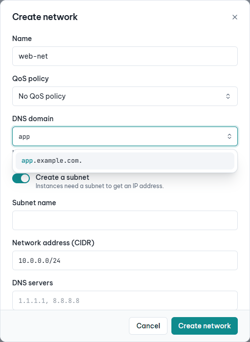
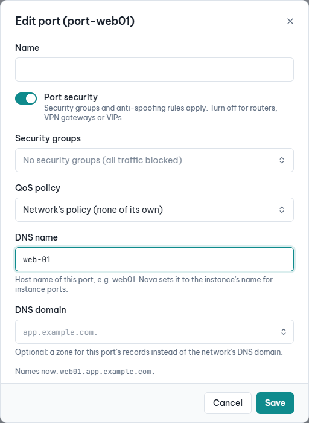
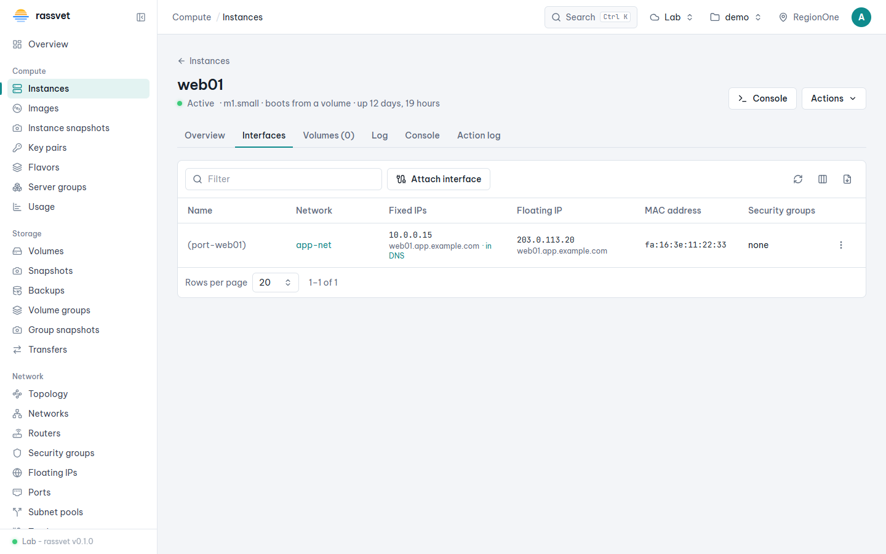
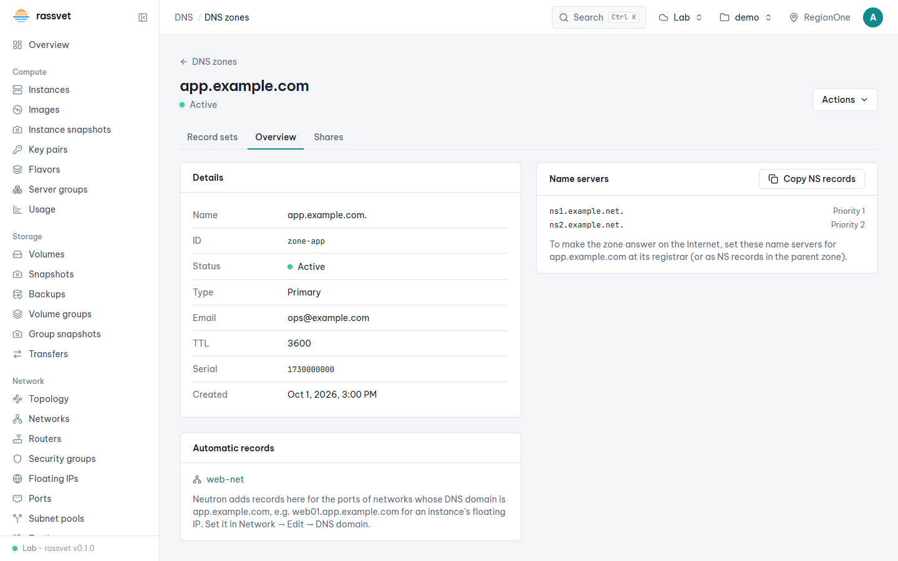
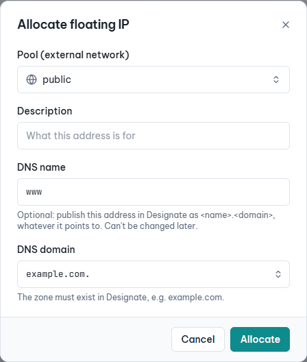

# DNS zones (Designate)

## Use case

You own a domain (say `example.org`) and want its DNS records next to the instances and load balancers they
point at, instead of in a registrar's web form. Or a mail server needs its floating IP to resolve back to
`mail.example.org`. Rassvet shows **DNS → DNS zones** and **DNS → Reverse DNS** when the cloud has
Designate.

## Create a zone

1. Go to **DNS → DNS zones** and click **Create zone** (or press Ctrl/⌘ K and choose *Create DNS zone*).
2. Enter the **Domain name** (`example.org`; the trailing dot is added for you) and a contact **Email**
   (published in the zone's SOA record). Leave **TTL** empty to use the cloud's default.

   
3. Click **Create zone**. Designate creates the SOA and NS records; the zone shows *Pending create* until the
   DNS servers have it, then *Active*.
4. On the zone's **Overview** tab, **Name servers** lists Designate's servers. Click **Copy NS records** and set
   those name servers for the domain at your registrar (or as NS records in the parent zone). Until then the
   zone only answers when its name servers are asked directly.

   

The cloud may restrict which domains are allowed (TLDs and blacklists set by the admins) and how many zones a
project may have.

**Secondary zones** copy their records from other DNS servers by zone transfer: choose **Secondary** as the
type and enter the primary servers' addresses. Their records are read-only; use **Transfer from primaries
now** to pull changes without waiting for the refresh interval.

## Add records

1. Open the zone; the **Record sets** tab lists its records (SOA and the apex NS are managed by Designate).

   

2. Click **Create record set**, type the **Name** inside the zone (`www`, `@` for the zone itself, `*` for a
   wildcard) and choose the **Type**.
3. Enter the **Values**, one per line. The hint under the box shows the format of the type, for example
   `10 mail.example.org.` for MX. Names that are values (CNAME, MX, NS, SRV, PTR) end with a dot.
   TXT values without quotes are quoted for you, and long ones (DKIM keys) split into 255-character strings.

   

4. Click **Create record set**. Edit or clone it later from its ⋮ menu.

Changes reach resolvers once their cached copy expires, so lower the TTL of a record a while before you
change it.

## Import and export zone files

- **Import zone** (on the DNS zones page) takes a BIND zone file — pasted or chosen from disk — with
  `$ORIGIN`, an SOA and NS records. The import runs as a task: the **Imports** tab shows when it is complete,
  with a link to the new zone, or why it failed.
- **Export zone file** (zone menu) writes a zone's records to a BIND file. When the export on the **Exports**
  tab is complete, click **Download**.

## Move a zone to another project

1. In the zone's menu choose **Transfer to another project**. Optionally restrict it to one target project ID.
2. Send the **Request ID** and **Key** shown to the other project (they stay available under
   **Transfer requests → Show ID and key**).
3. In the other project, click **Accept transfer** on the DNS zones page and enter both values. The zone and
   its records move; cancel a request you no longer want from the **Transfer requests** tab.

## Share a zone

On Designate 2023.1 or later, the zone's **Shares** tab lets other projects create record sets in your zone
(for example a team that publishes its own hosts under `apps.example.org`) without owning it. **Share zone**
takes the other project's ID; **Stop sharing** works once that project has no record sets left in the zone.

## Reverse DNS of floating IPs

1. Go to **DNS → Reverse DNS**. Every floating IP of the project is listed with its PTR record, if any.

   

2. Choose **Set PTR record** in its menu and enter the name, e.g. `mail.example.org`. Designate publishes it in
   the cloud's reverse zone (`10.113.0.203.in-addr.arpa.` for `203.0.113.10`).
3. Mail servers also check the forward direction: add an A record for the same name pointing at the address.

**Unset PTR record** gives the address its default name back. A PTR record goes away when the floating IP is
released.

## Automatic records for instances (Neutron DNS integration)

When the operator has integrated Neutron with Designate, Neutron writes the records of your instances for
you: give a network a **DNS domain** (one of your zones) and every floating IP associated with a port on it gets
an A record named after the port, e.g. `web01.app.example.com`. Clouds without the integration show none of
these fields; the zone's **Overview** then says so, and you add records by hand as above.

1. Create the zone first (see [Create a zone](#create-a-zone)), e.g. `app.example.com.`.
2. Go to **Network → Networks** and create a network, or open one and choose **Edit**. In **DNS domain** pick the
   zone from the suggestions (the trailing dot is added for you).

   

3. Launch instances on the network: Nova sets each instance port's **DNS name** to the instance's name. To use
   another name, edit the port (**Network → Ports → Edit**); the dialog shows the names the port has now. Where
   the cloud allows it, a port can also have a **DNS domain** of its own instead of the network's.

   

4. Associate a floating IP with the instance. Neutron adds the record to the zone; the network's **Overview**
   shows its DNS domain and **Ports** lists each port's DNS name.

The instance's **Interfaces** tab (and a network's **Ports** tab) shows the names under the addresses: under a
fixed IP its name inside the network, under the floating IP the name published in Designate.

Only floating IPs are published, unless the subnet publishes fixed IPs too: where the cloud allows it, turn on
**Publish fixed IPs in DNS** when you create or edit the subnet. Its fixed IPs then show *· in DNS*, and the
**Subnets** tab says which subnets do.

The zone's **Overview** lists the networks whose DNS domain it is:

A floating IP can also get a name of its own, whatever it points to: in **Network → Floating IPs → Allocate**,
enter a **DNS name** and a **DNS domain** (both are needed). Neutron sets these only when the address is
allocated; to change them, allocate a new address.

